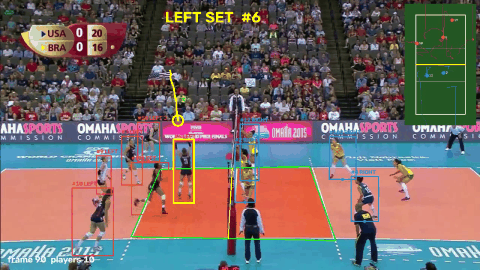
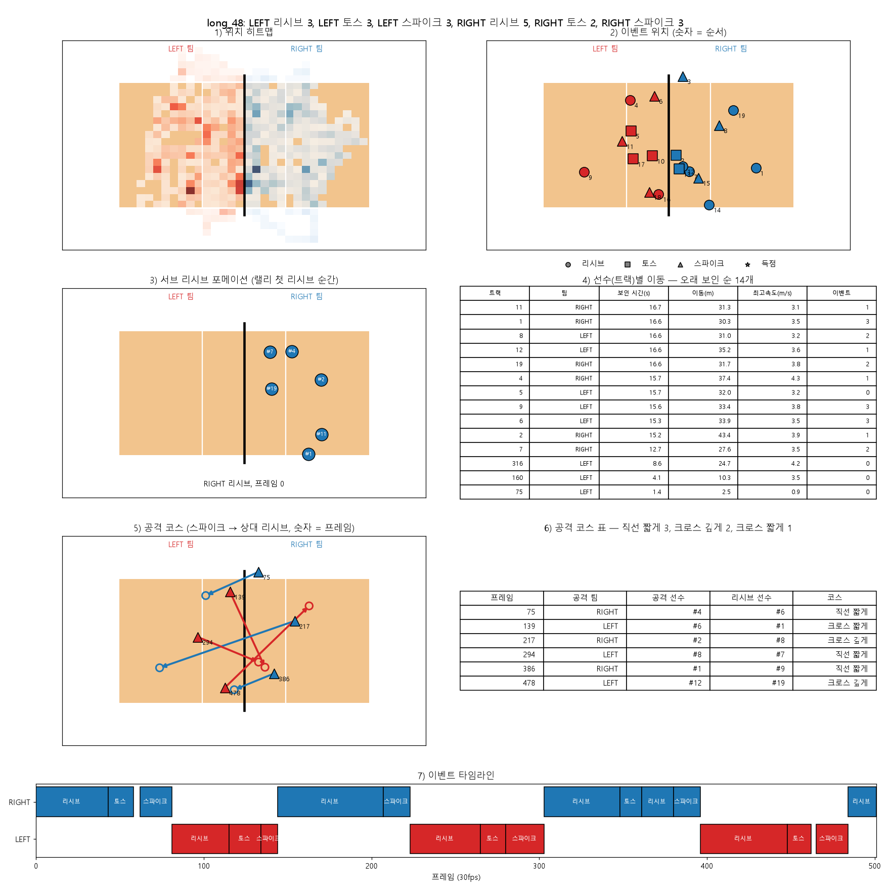
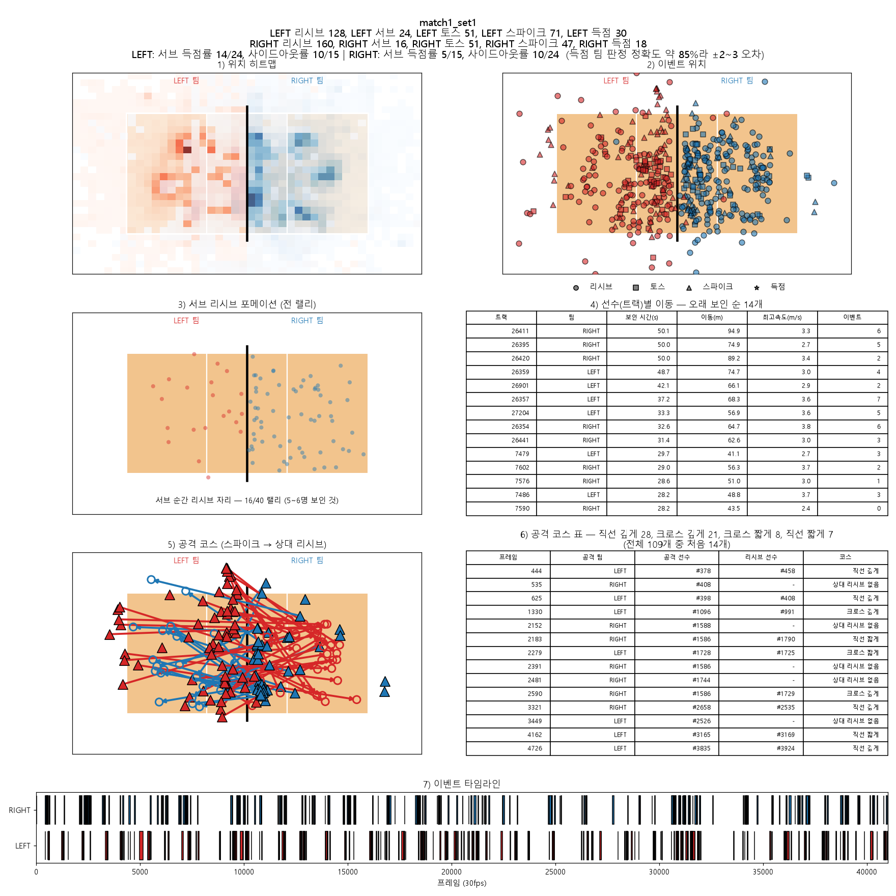

# vb_trk — 배구 중계 영상 전력분석

중계 영상 하나를 넣으면 **선수 추적 → 코트 위치(미터) → 팀 → 누가 언제 리시브·토스·스파이크했는지 → 공 궤적 → 공격 코스 → 분석 그림**까지 자동으로 뽑는 오프라인 파이프라인.
RTX 4060 Laptop (8GB) 한 대에서 학습·추론.



*테스트 영상(학습에 안 쓴 Omaha 2015 경기). 박스 = 선수(LEFT 빨강 / RIGHT 파랑), 위 글자 = 현재 이벤트, 노란 박스 = 공을 만진 선수, 노란 원·꼬리 = 공, 오른쪽 위 = 미니맵*

### 한눈에 보기 (Volleyball Dataset 공식 test split)

| 단계 | 지표 | 결과 |
|---|---|---|
| 선수 검출·추적 | 재현율 / 정밀도 (IoU≥0.5) | **0.847 / 0.973** |
| 개인 동작 5종 | 정확도 | **0.926** |
| 팀 행동 8종 | 정확도 | **0.924** |
| 이벤트 (팀 행동 + 공 만진 선수) | 정확도 | **0.874** |
| 공 검출 | F1, 중심 4px 이내 (TrackNetV2 0.836, WASB 0.880) | **0.842** |
| 속도 | 1시간 경기 (RTX 4060 Laptop) | 약 5시간 |



*분석 페이지 (long_48): 팀별 위치 히트맵, 이벤트 위치, 리시브 포메이션, 선수별 이동, 공격 코스 지도·표, 이벤트 타임라인*

## 파이프라인

```
영상 ─┬─ SAM3 (코트·네트 기둥 마스크, 10프레임마다) → 코트 영역의 보이는 변(사이드라인·끝선) + 네트 선(센터라인) → 호모그래피 + 흰 라인 ICP
      │     (앵글 무관, 실패하면 안쪽 라인 라벨 조합) → 흰 라인 일치도 검증 → 튀는 값 제거·보간
      │
      └─ YOLO26m (사람) + BoT-SORT → 발 위치를 코트 좌표(m)로 → 팀 = 네트 기준 코트 반쪽 (화면 기준 LEFT/RIGHT)
             → 영상 전체를 본 뒤: 끊긴 트랙 재연결, 트랙 시간의 절반 이상 코트 안에 있는 트랙만 선수 (심판·선심·코치·벤치 제외)
                                                                                     run.py
      ┌─ 선수 크롭 → YOLO26s-cls 특징 → ±8프레임 시간축 헤드 → 선수별 5종 (block/dig/set/spike/other)
      ├─ 프레임 전체 → YOLO26m-cls 특징 → ±8프레임 시간축 헤드 → 팀 행동 8종
      └─ 융합(로지스틱 회귀) → 팀 행동 (LEFT/RIGHT × pass/set/spike/winpoint)
             → 구간 = 이벤트, 그 팀에서 해당 동작 확률 최고인 1명 = 공 만진 선수
             → 득점 판정 거르기: 뒤에 동작이 이어지면 랠리 중, 10초 안 득점은 하나로    events.py

영상 ─── YOLO26s 1280 (공, 파인튜닝) → 프레임당 후보 5개 → 앞뒤 프레임 지지·구멍 보간 ball_video.py

→ 히트맵, 이벤트 지도, 서브 순간 포메이션, 이동 거리·속도, 공격 코스(스파이크 → 상대 리시브), 타임라인,
  랠리 단위 기록(서브 팀·이긴 팀·접촉 수, 서브 득점률·사이드아웃률)                     analysis.py
```

설계 원칙: **역할 분리**. 코트는 학습 없는 SAM3, 사람은 YOLO, 동작은 시간축 분류기. 팀은 유니폼 색이 아니라 *코트 위치*로 판정 (리베로·조명 변화에 강함).

## 실제 중계 영상 (모델 학습에 안 쓴 방송 경기)

2026 제주 한·중·일 여자배구 탑 클럽 슈퍼매치 (KBS N 중계, 오사카 vs 현대건설). 유튜브 구간: 1세트 23분, 2세트 앞 15분.
데이터셋과 달리 클로즈업·리플레이·풍경 컷이 섞이고 카메라가 측면·모서리·위에서 내려다보는 앵글로 계속 바뀐다.
**득점 판정 규칙은 1세트에서만 맞추고 2세트에는 손대지 않고 재확인했다.**

*(방송 화면은 저작권 때문에 저장소에 싣지 않았다. 아래 수치·그래프만 공개한다.)*

| | 1세트 (23분) | 2세트 앞 15분 | 3세트 (41분)* |
|---|---|---|---|
| 실제 득점 중 맞게 찾음 | 38 / 44 (가짜 9) | 26 / 27 (가짜 3) | 20 / 22 (가짜 5) |
| 랠리 시작의 서브 팀 | 34 / 38 | 21 / 25 | 16 / 21 |
| 코트 잡은 프레임 (보간 포함) | 14,518 / 41,059 (나머지는 클로즈업·리플레이·풍경) | 9,835 / 26,973 | 19,136 / 73,565 |
| 선수 트랙에서 코트 밖 행 | 5.8 % (코치·선심 제외 전 14.5 %) | 5.3 % |



*1세트 분석 (LEFT = 화면 왼쪽 코트). 득점·서브는 평가 정답과 비교한 값이고, 정답은 방송 점수판을 읽어 만든 평가용 파일일 뿐 파이프라인은 점수판을 쓰지 않는다 (점수판 없는 영상에서도 돌아야 하므로)*

채점은 `score_match.py`로 재현된다 (정답 CSV는 평가 전용). \* 3세트는 방송 점수판이 최대 6분씩 가려져서, 점수판이 계속 보이는 구간의 22점만 채점했다 (규칙은 1세트에서만 맞췄고 2·3세트에는 손대지 않음).

경기 중 와이드 화면 99장으로 본 코트 인식: 일반 측면 앵글 84 %, 위에서 내려다보는 리플레이 앵글 36 % (카메라가 빠르게 움직여 궤적 필터에 걸림).

## 결과 (Volleyball Dataset, Ibrahim et al. CVPR 2016, 공식 test split 16개 영상)

**1차: 선수 검출·추적** (레이블 프레임 80장, 정답 박스와 IoU≥0.5)

| 단계 | 재현율 | 정밀도 |
|---|---|---|
| YOLO26m 단독 (상한) | 0.907 | |
| 추적 + 관중석 제거 | 0.872 | |
| 최종, ByteTrack | 0.826 | 0.959 |
| **최종, BoT-SORT (카메라 움직임 보정) + 겹침 허용 재연결** | **0.847** | **0.973** |

- 코트 검출 79/80, 팀 판정 93% (동작 중인 선수)
- 개선 과정: 코트 바닥색 필터 (코트 검출 46→79/80, 재현율 0.47→0.78), YOLO11s→26s→26m (0.78→0.83), 코너 선심 제외 (정밀도 0.94→0.96)

**2차: 동작 인식** (test 선수 15,526명 / 장면 1,337개)

| 과제 | 방법 | 정확도 | 평균 클래스 정확도 |
|---|---|---|---|
| 개인 동작 9종 | 크롭 1장 (YOLO26s-cls) | 0.774 | 0.722 |
| | ±8프레임 특징 + 1D conv 헤드 | 0.810 | 0.729 |
| 개인 동작 5종 (전력분석용) | ±8프레임 헤드 | **0.926** | **0.872** |
| 팀 행동 8종 | 선수 단서만 | 0.752 | 0.699 |
| | 프레임 전체만 (YOLO26m-cls) | 0.882 | 0.893 |
| | **선수 + 프레임 융합** | **0.924** | **0.930** |
| **이벤트** (팀 행동 + 공 만진 선수 모두 정답) | 융합 + 팀 내 1명 선택 | **0.874** | |

- 실패한 시도도 기록: 흑백 3프레임을 3채널로 겹치기는 오히려 하락 (0.774→0.741). 선수 분류기를 m으로 키워도 차이 없음
- 득점(winpoint) 장면은 선수 단서만으로는 0.07~0.53 → 프레임 전체 단서로 0.97

**3차: 공 검출** (Perez et al. 2022 공 위치 레이블, test 43,628프레임, 정답 중심 4px 이내 = 맞음, WASB 논문과 같은 지표)

| 방법 | F1 (4px) | F1 (10px) |
|---|---|---|
| TrackNetV2 (WASB 논문 보고) | 0.836 | |
| WASB (BMVC 2023, 3프레임 히트맵) | 0.880 | |
| YOLO26s 1280 단일 프레임 | 0.832 | 0.897 |
| **+ 궤적 후처리** | **0.842** | **0.910** |

- 남은 오차는 대부분 위치 오차 (4~10px 어긋남 약 12%, 엉뚱한 물체 약 6%)
- 공격 코스: 스파이크한 선수 자리 → 상대 리시브 선수 자리, 직선/크로스·짧게/깊게

**긴 영상 실제 파이프라인** (데이터셋 레이블 폴더를 이어 붙인 12~17초 영상, YOLO 트랙 기준)
- 테스트 영상 long_20: 레이블 프레임 11/11 팀 행동, 10/11 공 만진 선수 (ByteTrack일 때 11/11)
- 먼 쪽 팀 트랙 끊김: 상위 6개 ID 비율 long_20 0.865→0.898, long_48 0.915→0.941 (ReID는 영상마다 들쭉날쭉해 제외)

**속도** (RTX 4060 Laptop)
- SAM3 코트 인식 프레임당 ~1초가 병목 → 10프레임마다 + 실패 시 재시도 + 남은 구멍만 촘촘히: 코트 오차 중앙 3cm, 결과 동일
- 1시간 경기 예상: 매 프레임 약 32시간 → **약 5시간** (SAM3 3~4h, 추적 1h, 동작 30분)

## 결과 뷰어 (UI)

분석은 명령줄로 따로 돌리고, 결과는 브라우저 화면으로 본다 (영상을 올리는 즉시 분석하는 실시간 도구는 아님).

```bash
python app.py            # http://localhost:8000 이 열린다 (--outputs, --data, --port 로 경로·포트 변경)
```

- **복기 탭:** 랠리 목록에서 하나를 고르면 그 구간(앞뒤 2초 여유)의 영상이 재생되고, 영상 위에 선수 박스(LEFT 빨강 / RIGHT 파랑)·공 위치와 꼬리·이벤트 글자가 겹쳐 그려진다. 코트 지도에는 선수 위치와 접촉 위치(번호순)가 나온다. ↑↓ 키로 이전·다음 랠리.
- **경기 통계 탭:** 팀별 득점, 서브 득점률, 사이드아웃률과 분석 그림.
- 필요한 것: `outputs/<이름>_{rallies,events,tracks,ball}.csv`(파이프라인 산출물)와 `data/<이름>.mp4` (영상은 저장소에 없음, DVC). 경기 = 랠리가 있는 `<이름>_rallies.csv`.
- **솔직한 한계:** 득점 팀은 '다음 랠리의 서브 팀'으로 추정한 값이라 판정 약 85%다 (화면 위에 상시 표시). 코트를 못 잡은 구간(클로즈업·리플레이)은 박스가 없고 타임라인에 회색으로 표시된다. 접촉 수 2 이하·5초 미만·득점 팀 없음인 랠리는 ⚠로 표시한다.
- 브라우저는 Chrome·Edge 기준 (VP9 영상 재생). 데이터셋 클립(MPEG-4)은 브라우저가 못 읽어 목록에 나오지 않는다.

## 서빙 (FastAPI)

선수 검출 모델을 이미지 API로 서빙한다 (`serve.py`). Prometheus 메트릭(요청 수·추론 지연·프레임당 사람 수) 포함.

```bash
uvicorn serve:app --port 8000
curl -F "file=@frame.jpg" "http://localhost:8000/detect?conf=0.3"   # {"persons":[{"box":[x1,y1,x2,y2],"score":0.89}, ...], "ms": 35.2}
```

## MLOps

| 항목 | 구성 | 상태 |
|---|---|---|
| 서빙 | `serve.py` (FastAPI) | 로컬 서버·테스트로 확인 |
| 컨테이너 | `Dockerfile`, `docker-compose.yml` (서비스 + Prometheus + Grafana) | 실제 빌드·기동 확인 (Docker Desktop) |
| 실험·모델 관리 | MLflow: `mlops/log_mlflow.py` → 실험 `vb_trk`, 레지스트리 `vb_ball_detector`·`vb_player_detector` (alias `champion`) | 실행·조회 확인 |
| 데이터·가중치 버전 | DVC: 영상·가중치 추적, 로컬 원격에 push, 원격에서 복원 검증 | 확인 |
| 모니터링 | `/metrics` → Prometheus (`monitoring/`, 경고 규칙 3개, Grafana 대시보드 JSON) | Prometheus 스크레이프·Grafana 대시보드 쿼리 확인 (컨테이너에서) |
| 드리프트 | Evidently: `mlops/drift.py` → HTML 리포트 + `retrain` 플래그 | 보정은 표본이 적음 (ROADMAP) |
| CI | `.github/workflows/ci.yml` (CPU torch, pytest) | 깨끗한 가상환경에서 의존성·테스트 재현, GitHub Actions 실제 실행 성공 (1분 7초) |

MLflow·DVC·Evidently는 파이프라인 환경을 건드리지 않게 별도 가상환경 `.venv-mlops`에 설치했다. 채점(`score_match.py`)은 파이프라인 환경, 기록(`log_mlflow.py`)은 `.venv-mlops`에서 돈다.

`serve.py`의 `/detect`는 프레임의 사람 전부(관중 포함)를 돌려주고, 선수 판정은 영상 전체를 보는 `run.py` 단계에서 한다.

## 설치

```
conda create -n vbtrk python=3.11 -y
conda activate vbtrk
pip install torch torchvision --index-url https://download.pytorch.org/whl/cu130
pip install -r requirements.txt
```

- SAM3: Hugging Face `facebook/sam3` (접근 승인 필요). 한 번 받아두면 오프라인으로 씀
- YOLO 가중치(`yolo26m.pt`, `yolo26s-cls.pt`, `yolo26m-cls.pt`)는 ultralytics가 처음 실행 때 자동 다운로드
- 데이터: [Volleyball Dataset](https://github.com/mostafa-saad/deep-activity-rec) (연구용, 저장소에 포함 안 함) → `data/volleyball/videos/`

## 실행

```
# 1) 추적: outputs/<영상>_tracked.mp4, _tracks.csv (코트는 <영상>.courts*.json 캐시)
python run.py --video data/long_20.mp4                  # --court-stride 1 이면 SAM3 매 프레임
# 2) 이벤트: outputs/<영상>_events.csv, _events.mp4
python events.py --video data/long_20.mp4
# 3) 공: outputs/<영상>_ball.csv, _ball.mp4
python ball_video.py --video data/long_20.mp4
# 4) 분석: outputs/<영상>_analysis.png, _players.csv
python analysis.py --video data/long_20.mp4

python test_vbtrk.py                                    # 영상 없이 자가 점검 (24개)
```

평가·학습 재현:

```
python eval.py --per-video 5                            # 1차 검출·추적 평가
python action_data.py                                   # 선수 크롭 데이터셋
yolo classify train model=yolo26s-cls.pt data=data/actions imgsz=224 epochs=30 project=outputs/action_cls name=base
python action_temporal.py --merge --out outputs/action_cls/temporal_head5.pt
python action_temporal.py --out outputs/action_cls/temporal_head.pt
python action_frames.py data                            # 프레임 데이터셋 (좌우 반전 + l/r 교환)
yolo classify train model=yolo26m-cls.pt data=data/team_frames imgsz=448 fliplr=0 epochs=30 batch=32 project=outputs/action_cls name=frames_m
python action_frames.py feats m && python action_frames.py head m
python action_team.py                                   # 조합 비교 + 융합 분류기 저장
python ball_data.py && yolo detect train model=yolo26s.pt data=data/ball/ball.yaml imgsz=1280 epochs=30 batch=4 project=outputs/ball name=y26s_1280
python ball_eval.py && python ball_track.py               # 공 검출 평가 (단일 프레임 / 궤적 후처리)
python stitch_clip.py 20 49840 50210 data/long_20.mp4   # 긴 테스트 영상 만들기
```

## 구조

| 파일 | 역할 |
|---|---|
| `vbtrk/court_sam3.py` | SAM3 마스크 → 코트 라인 → 호모그래피, 튀는 값 제거·보간, 간격 검출 |
| `vbtrk/court.py` | 코트 좌표계(9×18m), 프리존, 사이드 판정, 화면 왼쪽 팀 |
| `vbtrk/team.py` | 팀 다수결, 점프 중 착지 위치 유지, 트랙 재연결, 선수 판정 |
| `vbtrk/viz.py` | 박스, 코트 오버레이, 미니맵 |
| `run.py` | 추적 메인 |
| `serve.py` | 선수 검출 FastAPI 서빙 (`/detect`, `/health`, `/metrics`) |
| `score_match.py` | 실제 경기 채점 (평가 전용 정답 CSV와 비교) |
| `mlops/` | `log_mlflow.py` (MLflow 기록·모델 등록), `drift.py` (Evidently 드리프트) |
| `monitoring/` | Prometheus 스크레이프·경고 규칙, Grafana 프로비저닝·대시보드 |
| `action_*.py` | 동작 데이터·학습·평가 (선수 / 프레임 / 융합) |
| `events.py` | 추적 결과 → 이벤트 |
| `analysis.py` | 이벤트·추적 → 분석 그림·표 |
| `ball_*.py` | 공 데이터·평가·궤적 후처리·영상 추적 |
| `eval.py` | 1차 정량 평가 |

## 한계와 다음 단계

- 먼 쪽 네트 앞 선수 트랙 끊김 (긴 영상 선수 ID 15~16 / 실제 12). 같은 팀은 유니폼이 같아 색·ReID로는 한계 → 등번호 인식
- 학습 데이터에 '동작 없음' 구간이 없어 모든 프레임이 8종 팀 행동 중 하나로 분류됨
- 서브는 서버를 직접 보지 않고 '득점 뒤 코트에 선수 8명 이상 2초' + '직전 득점 팀이 서브'로 추정 (중계가 서브 직전 클로즈업이라 서버가 거의 안 보임). 득점 팀 판정이 85 % 수준이라 서브 득점률·사이드아웃률은 ±2~3 오차
- 위에서 내려다보는 리플레이 앵글의 코트 인식 36 %, 득점 판정에 가짜가 남음 (1세트 10개)
- 득점 규칙 값(3초·10초)은 한 경기로 맞춤. 다른 대회·다른 중계로는 재확인 필요
- 공격 코스 도착점은 상대 리시브 선수 발 위치 근사: 블로커 터치도 리시브로 잡혀 '짧게'가 과대. 득점(바닥) 스파이크는 도착 없음 → 공 궤적 바운드 지점으로
- 공 레이블(Perez et al. 2022)은 라이선스 표기 없음 (연구용, 인용)
- 세부 기록: [ROADMAP.md](ROADMAP.md)

## 라이선스·이용 조건

- 이 저장소 코드: **AGPL-3.0** ([LICENSE](LICENSE)). 선수·공 검출에 쓰는 Ultralytics YOLO가 AGPL-3.0이라 같은 조건을 따른다.
- 저장소에 **없는 것**: 모델 가중치(`*.pt`, DVC 포인터만), 실험 영상, 방송 중계 영상. SAM3(`facebook/sam3`)는 Hugging Face에서 이용 조건에 동의해야 받을 수 있다.
- 데이터: Volleyball Dataset (Ibrahim et al., CVPR 2016), 공 위치 레이블 (Perez et al., 2022). 연구용이며 각 출처의 조건을 따른다.
- `docs/demo.gif`·`docs/analysis.png`는 Volleyball Dataset 영상으로 만든 결과 그림이다. 방송 경기 분석 그림(`match1_set1_analysis.png`)은 영상 프레임 없이 좌표만 그린 그래프다.
